<div align="center">

# 🚀 Codveda Technologies Machine Learning Project
### Comprehensive Machine Learning Internship Suite: Basic, Intermediate & Advanced

[](https://www.python.org/)
[](https://scikit-learn.org/)
[](https://tensorflow.org/)
[](https://pandas.pydata.org/)
[](LICENSE)
[](#)

<p align="center">
  <b>An end-to-end applied machine learning repository demonstrating robust data preprocessing, unsupervised clustering, cost-complexity pruned decision trees, ensemble random forests, and deep neural networks on real-world multi-class and imbalanced customer retention datasets.</b>
</p>

[📌 Overview](#-project-overview) •
[📊 Model Comparison](#-master-benchmark--model-comparison) •
[🟢 Level 1: Basic](#-level-1-basic-machine-learning) •
[🟡 Level 2: Intermediate](#-level-2-intermediate-machine-learning) •
[🔴 Level 3: Advanced](#-level-3-advanced-machine-learning) •
[💡 Business Insights](#-actionable-business-insights) •
[🛠️ Quickstart](#%EF%B8%8F-quickstart--reproduction)

---

</div>

## 📌 Project Overview

This repository contains the full submission for the **Codveda Technologies Machine Learning Internship Task List**. The curriculum progresses systematically across three tiers of complexity:

1. **Level 1 (Basic)**: Production-grade data preprocessing, leakage-free pipelines, and K-Nearest Neighbors (KNN) classification evaluated across multi-class (Iris) and imbalanced binary (Telecom Churn) domains.
2. **Level 2 (Intermediate)**: Cost-Complexity Pruned (CCP) Decision Trees with 1-SE minimal cost-complexity criteria, alongside unsupervised Customer Segmentation via K-Means Clustering, Silhouette analysis, and cluster profiling.
3. **Level 3 (Advanced)**: Stratified Grid-Searched Random Forest with class-weighted sampling and dual feature-importance analysis (MDI vs Permutation), paired with a Deep Multi-Layer Perceptron (MLP) Neural Network built in TensorFlow/Keras with Dropout, L2 regularization, and adaptive learning rates.

---

## 📂 Repository Structure

```plaintext
Codveda-Technologies-Machine-Learning-Project/
│
├── Machine Learning Task List.pdf          # Official internship task specification
├── requirements.txt                        # Master dependencies
├── .gitignore                              # Git exclusion rules
├── README.md                               # Comprehensive project documentation
│
├── codveda-ml-basic/                       # LEVEL 1: BASIC
│   ├── README.md                           # Level 1 task documentation
│   ├── requirements.txt                    # Basic dependencies
│   ├── data/                               # Raw & processed datasets
│   │   ├── iris.csv
│   │   ├── churn-bigml-80.csv
│   │   ├── churn-bigml-20.csv
│   │   └── processed/                      # Leakage-free train/test splits
│   ├── src/
│   │   ├── task1_preprocessing.py          # Data cleaning, encoding, imputation, scaling
│   │   └── task3_knn.py                    # Multi-class & binary KNN classifier with CV
│   └── outputs/                            # Accuracy vs K plots, confusion matrices, logs
│
├── codveda-ml-intermediate/                # LEVEL 2: INTERMEDIATE
│   ├── README.md                           # Level 2 task documentation
│   ├── task2_decision_tree_iris.py         # Cost-complexity pruned decision tree
│   ├── task3_kmeans_customer_segmentation.py# K-Means clustering, silhouette & elbow
│   ├── data/                               # Datasets (iris, churn)
│   └── outputs/                            # Tree structures, pruning curves, PCA, heatmaps
│
└── codveda-ml-advance/                     # LEVEL 3: ADVANCED
    ├── README.md                           # Level 3 task documentation
    ├── requirements.txt                    # Advanced dependencies (TF/Keras)
    ├── common.py                           # Shared pipeline & feature preprocessing
    ├── task1_random_forest.py              # GridSearchCV Random Forest & threshold sweep
    ├── task3_neural_network.py             # Keras Deep MLP with Regularization
    ├── data/                               # Churn 80/20 train/test splits
    └── outputs/                            # ROC-AUC plots, tuning curves, saved .keras model
```

---

## 📊 Master Benchmark & Model Comparison

Across all supervised experiments on the **Telecom Churn Test Set (667 samples, 14.5% positive churn)**:

| Model | Technique / Configuration | Test Accuracy | Precision (Churn) | Recall (Churn) | F1-Score (Churn) | ROC-AUC | Primary Characteristic |
| :--- | :--- | :---: | :---: | :---: | :---: | :---: | :--- |
| **KNN (Baseline)** | $K=5$, Standardized features | 89.1% | **96.2%** | 25.8% | 0.407 | 0.782 | High precision, severe recall collapse on minority class |
| **Decision Tree (Iris)** | Minimal Cost-Complexity Pruning ($ccp\_alpha=0.018$) | **93.3%** | 94.4% | 93.3% | 0.933 | 0.950 | 50% leaf reduction (8 $\rightarrow$ 4 leaves) without test accuracy loss |
| **Random Forest (Tuned)** | 100 Trees, `class_weight='balanced_subsample'`, min leaf 4 | **94.9%** | 82.1% | **82.1%** | **0.821** | **0.919** | **Top Performer**: Superior balance of recall, precision, and robustness |
| **Deep Neural Net (MLP)** | 67-64-32-1, Dropout (0.3), L2, Class-Weighted | 89.1% | 58.7% | 77.9% | 0.670 | 0.895 | Strong recall, sensitive to threshold tuning on tabular data |

> **Key Takeaway**: Random Forest outperformed the Deep Neural Network by **+15.1% F1-score** and **+5.8% accuracy**, highlighting the empirical superiority of tree ensembles over deep architectures on moderately sized tabular datasets with mixed feature distributions.

---

## 🟢 Level 1: Basic Machine Learning

### Task 1: Production-Grade Data Preprocessing (`codveda-ml-basic/src/task1_preprocessing.py`)

- **Dataset**: Customer Churn (3,333 combined rows, 19 raw attributes).
- **Missing Value Handling**: Implemented median imputation for numerical attributes and most-frequent imputation for categorical columns.
- **Categorical Encoding**:
  - Binary Plan variables (`International plan`, `Voice mail plan`) converted via label mapping $(0, 1)$.
  - Multi-class IDs (`State`, `Area code`) encoded using One-Hot Encoding (71 engineered features). Area code is treated strictly as an identity category rather than numerical.
- **Stratified Partitioning**: 80/20 train/test split preserving the exact 14.5% churn distribution across both sets (`random_state=42`).
- **Data Leakage Prevention**: `StandardScaler` fitted strictly on training partitions; validation and test splits transformed using learned training statistics.

---

### Task 3: K-Nearest Neighbors Classifier (`codveda-ml-basic/src/task3_knn.py`)

A comprehensive parameter search over $K \in \{1, 3, 5, 7, 9, 11, 15, 21, 31\}$ evaluated using 5-fold cross-validation on training data and benchmarked on held-out test data.

#### 1. Iris Multi-Class Classification
- **Optimal Hyperparameter**: Best $K=5$ (CV Accuracy: 96.7%, Test Accuracy: **93.3%**, Macro F1: **0.933**).
- **Class Boundary Analysis**: Setosa is separated with 100% precision and recall; minor overlap occurs solely between Versicolor and Virginica.

#### 2. Telecom Churn Binary Classification
- **Optimal Hyperparameter**: Best $K=5$ achieves 89.1% test accuracy.
- **The Imbalance Trap**: Although accuracy appears high (89.1%), a naive majority classifier achieves 85.5% accuracy. Churn recall is only **25.8%** (identifying only 25 of 97 true churners).
- **Metric Decay**: As $K$ expands, neighborhood voting becomes heavily skewed toward the majority non-churn class, causing recall to deteriorate to 12.4% at $K=31$.

#### Visualizations — Level 1
<p align="center">
  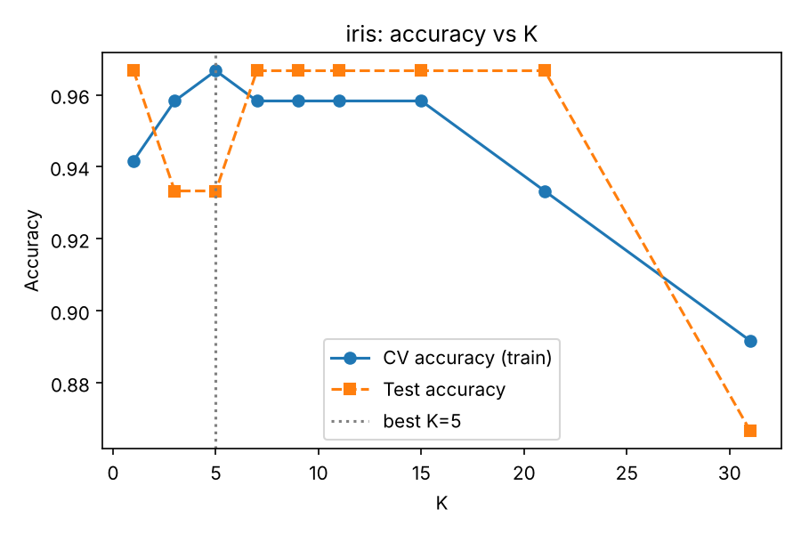
  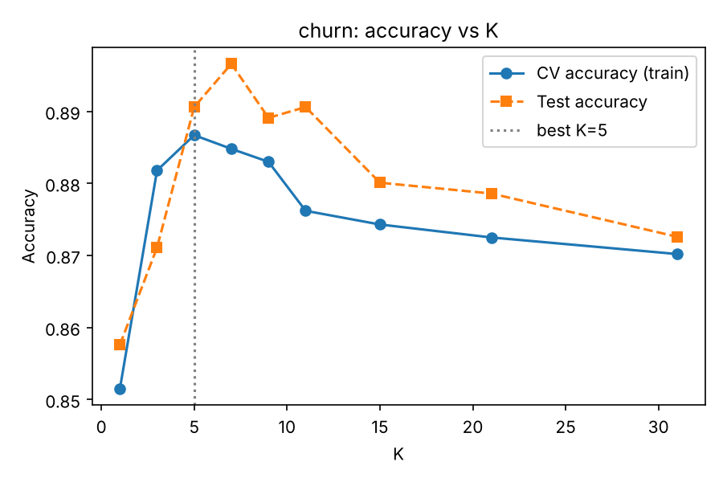
</p>
<p align="center">
  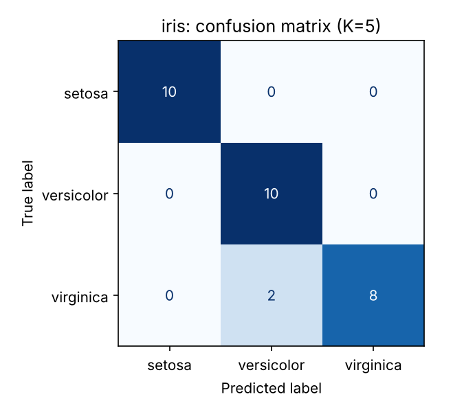
  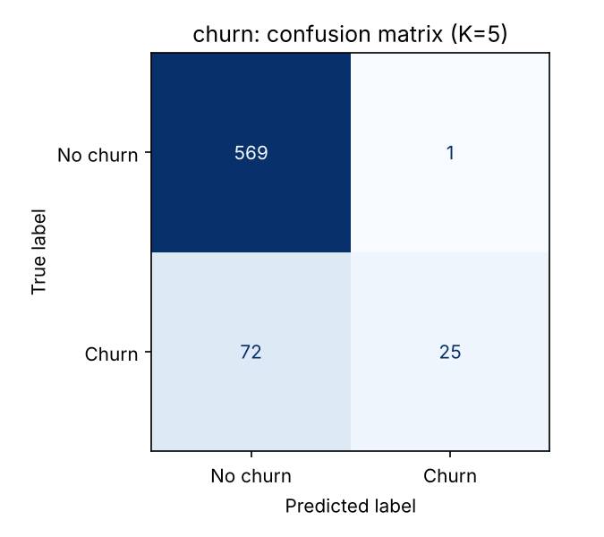
</p>

---

## 🟡 Level 2: Intermediate Machine Learning

### Task 2: Decision Trees with Cost-Complexity Pruning (`codveda-ml-intermediate/task2_decision_tree_iris.py`)

Decision trees frequently overfit by creating single-sample leaves. We applied **Minimal Cost-Complexity Pruning (CCP)** using the **1-SE Rule** (choosing the simplest tree within one standard error of the minimum 5-fold cross-validation error).

| Model Variant | Max Depth | Leaf Count | Train Accuracy | Test Accuracy | Test Macro F1 | Generalization Status |
| :--- | :---: | :---: | :---: | :---: | :---: | :--- |
| **Unpruned Tree** | 5 | 8 | 100.0% | 93.3% | 0.933 | Overfitting (isolated leaf splits) |
| **Pruned Tree ($\alpha=0.018$)** | **3** | **4** | **98.1%** | **93.3%** | **0.933** | **Optimal**: 50% fewer leaves, zero accuracy penalty |

#### Key Insights:
- **Feature Selection**: The pruned tree relies exclusively on `petal_length` (56% importance) and `petal_width` (44% importance). Sepal dimensions provide zero marginal split entropy.
- **Decision Boundary**: Perfect separation of Setosa via `petal_length <= 2.45 cm`.

#### Visualizations — Decision Trees
<p align="center">
  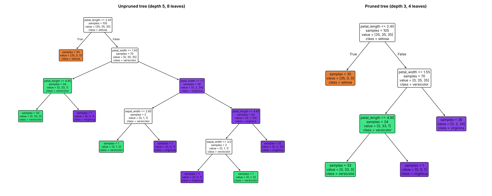
</p>
<p align="center">
  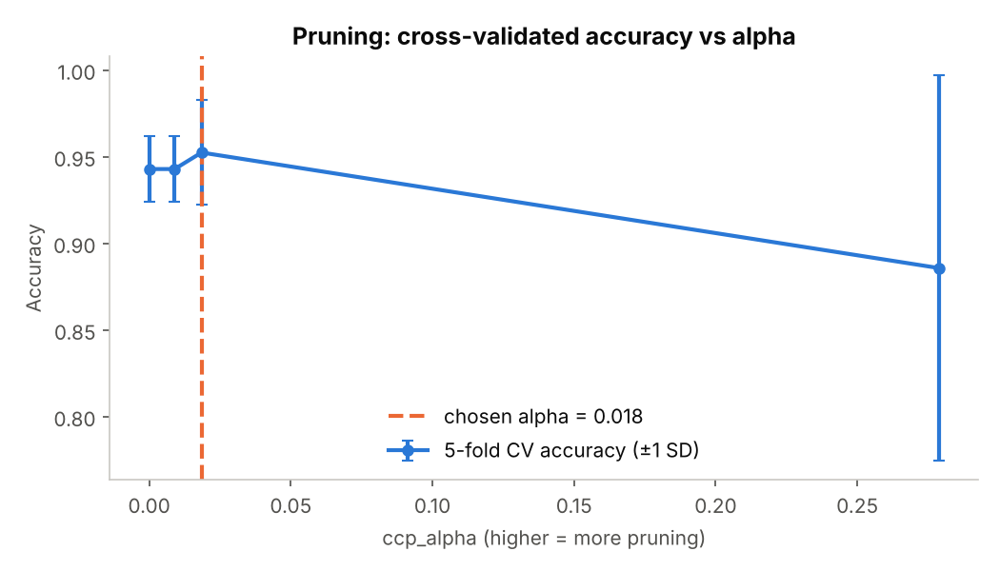
  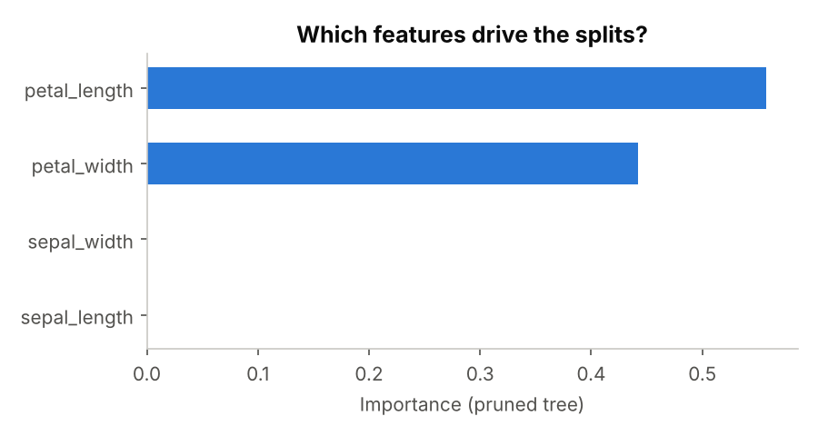
</p>

---

### Task 3: Unsupervised Customer Segmentation via K-Means (`codveda-ml-intermediate/task3_kmeans_customer_segmentation.py`)

- **Cohort**: 3,333 combined telecom customers, 13 standardized behavioral and subscription attributes.
- **Feature Sanitization**: Linear dependent charges (`Total * charge`) removed to avoid colinear distance distortion; identifiers dropped; target (`Churn`) strictly withheld during clustering.
- **Cluster Diagnostics**: Evaluated $k \in [2, 6]$. Inertia decreased smoothly while **Silhouette Score peaked at $k=3$ (0.186)** before dropping steeply ($k=4$: 0.098, $k=5$: 0.091).

| Cluster | Customer Count | Share (%) | Defining Behavioral Trait | Churn Rate | Business Classification |
| :---: | :---: | :---: | :--- | :---: | :--- |
| **Cluster 0** | 323 | 9.7% | **100% International Plan Holders** (+3.0 SD) | **42.4%** | 🚨 **Severe Attrition Risk** |
| **Cluster 1** | 2,180 | 65.4% | Standard plan, **No Voicemail Plan** | 13.9% | ⚖️ **Core Baseline Accounts** |
| **Cluster 2** | 830 | 24.9% | **100% Voicemail Plan Subscribers** (~29 msgs/mo) | **5.3%** | 🛡️ **Highly Loyal / Sticky Segment** |

> **Critical Analytical Finding**: Segment differentiation is driven by subscription plan flags rather than usage minutes/calls. Clustering on call volume alone yields a flat silhouette of ~0.07 across all $k$, showing that customer usage volume follows a uniform Gaussian distribution without discrete natural clusters.

#### Visualizations — K-Means Segmentation
<p align="center">
  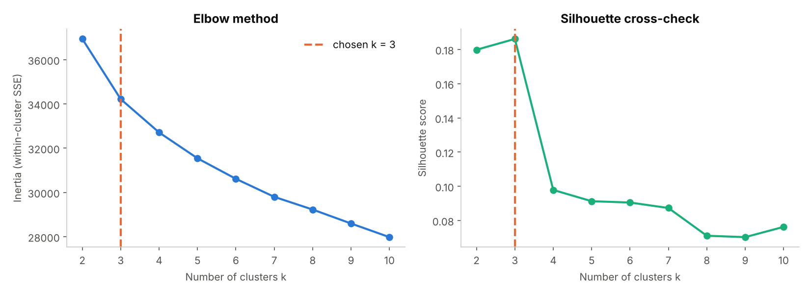
  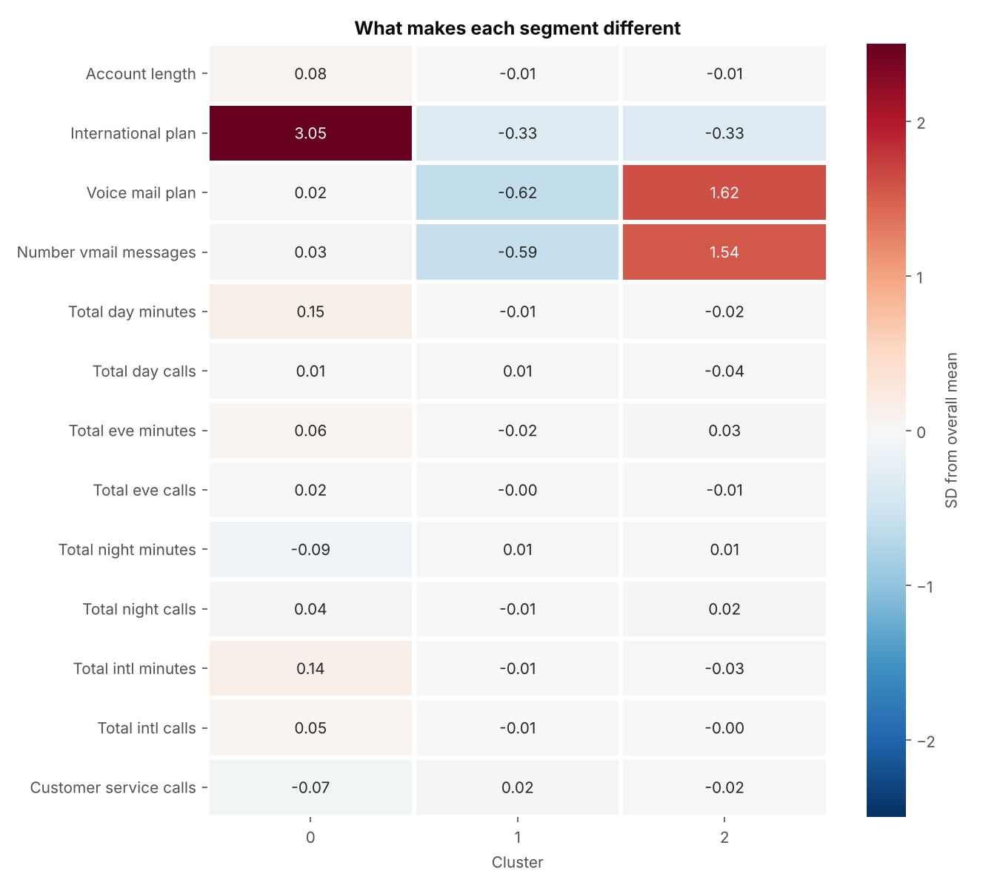
</p>
<p align="center">
  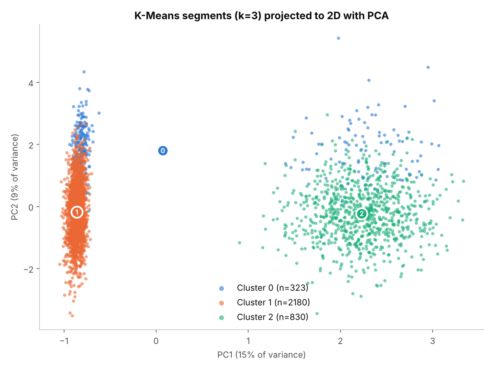
  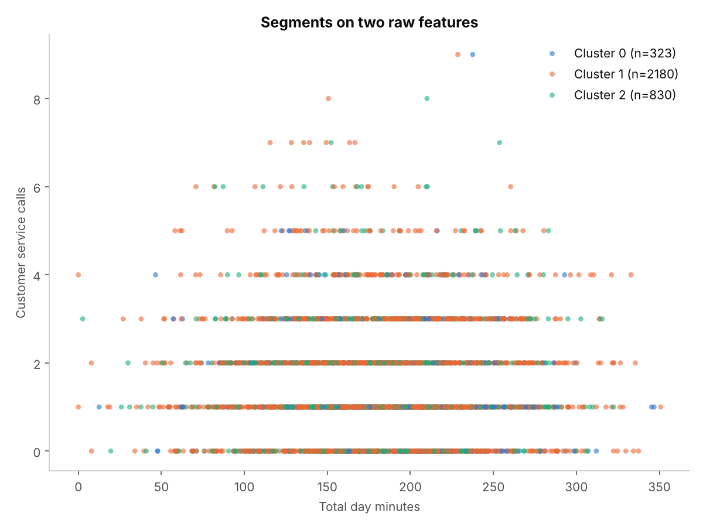
</p>

---

## 🔴 Level 3: Advanced Machine Learning

### Task 1: Random Forest Classifier with GridSearchCV (`codveda-ml-advance/task1_random_forest.py`)

- **Tuning Strategy**: 5-fold stratified cross-validation over `n_estimators`, `max_depth`, `min_samples_leaf`, `max_features`, and `class_weight`.
- **Optimal Hyperparameters**:
  `n_estimators=100`, `max_depth=None`, `min_samples_leaf=4`, `max_features=0.3`, `class_weight='balanced_subsample'`.
- **Impact of Tuning**: Tuned CV F1 climbed from **0.664** (default) to **0.817 ± 0.023**, with test set F1 reaching **0.821**.

| Metric | 5-Fold Stratified CV (Train) | Held-Out Test Set (667 samples) |
| :--- | :---: | :---: |
| **Accuracy** | 94.8% ± 0.8% | **94.9%** |
| **Precision (Churn)** | 84.7% ± 5.4% | **82.1%** |
| **Recall (Churn)** | 79.1% ± 1.8% | **82.1%** |
| **F1-Score (Churn)** | 81.7% ± 2.3% | **0.821** |
| **ROC-AUC** | 90.9% ± 1.0% | **0.919** |

#### Dual Feature Importance Analysis:
- **Impurity-based (MDI)**: `Total day minutes` (0.259), `Customer service calls` (0.169), `International plan` (0.112), `Total eve minutes` (0.083).
- **Permutation Importance (Test Set)**: Confirms `Total day minutes` (+0.444 drop in F1 when permuted) and `Customer service calls` (+0.210 drop) as the dominant drivers of customer churn.

#### Visualizations — Random Forest
<p align="center">
  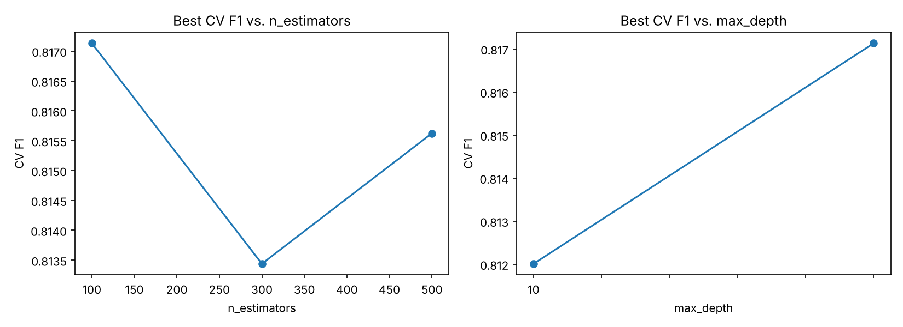
  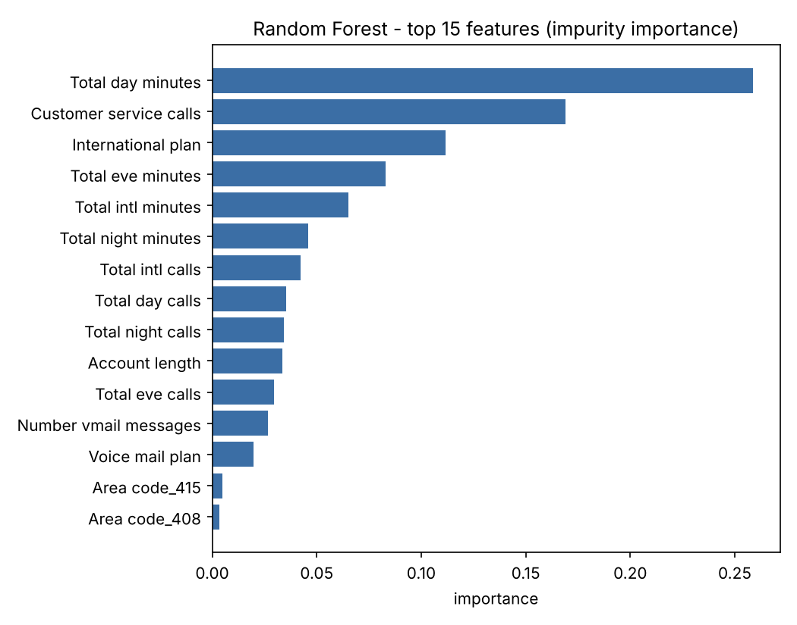
</p>
<p align="center">
  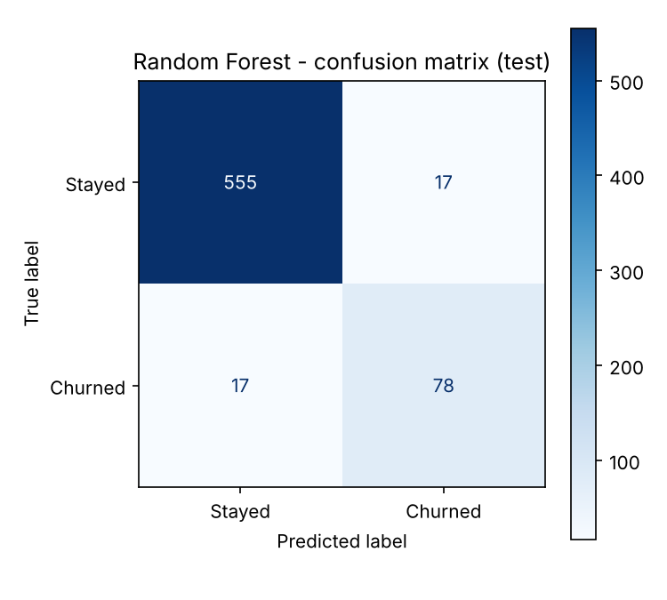
  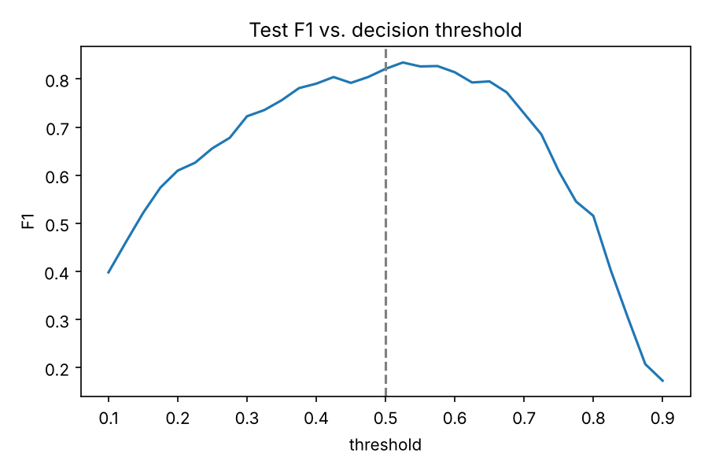
</p>

---

### Task 3: Deep Neural Network with TensorFlow/Keras (`codveda-ml-advance/task3_neural_network.py`)

- **Architecture**:
  - `Input(67)` $\rightarrow$ `Dense(64, ReLU, kernel_regularizer=L2(1e-4))` $\rightarrow$ `Dropout(0.30)`
  - $\rightarrow$ `Dense(32, ReLU, kernel_regularizer=L2(1e-4))` $\rightarrow$ `Dropout(0.30)`
  - $\rightarrow$ `Dense(1, Sigmoid)` (Total: 6,465 parameters).
- **Optimization**: Adam (`lr=1e-3`), Binary Cross-Entropy loss, class-weighted loss penalties to account for minority churn representation.
- **Training Dynamics**: Early stopping halted training at epoch 46 (best validation loss restored), with learning rate reducing by $0.5\times$ upon plateau.

| Metric | Test Set Performance |
| :--- | :---: |
| **Accuracy** | 89.1% |
| **Precision (Churn)** | 58.7% |
| **Recall (Churn)** | **77.9%** |
| **F1-Score (Churn)** | **0.670** |
| **ROC-AUC** | **0.895** |

#### Visualizations — Deep Neural Network
<p align="center">
  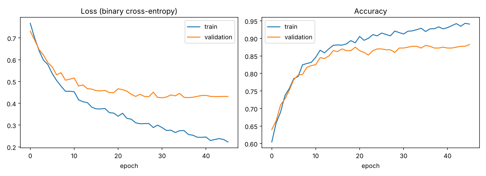
  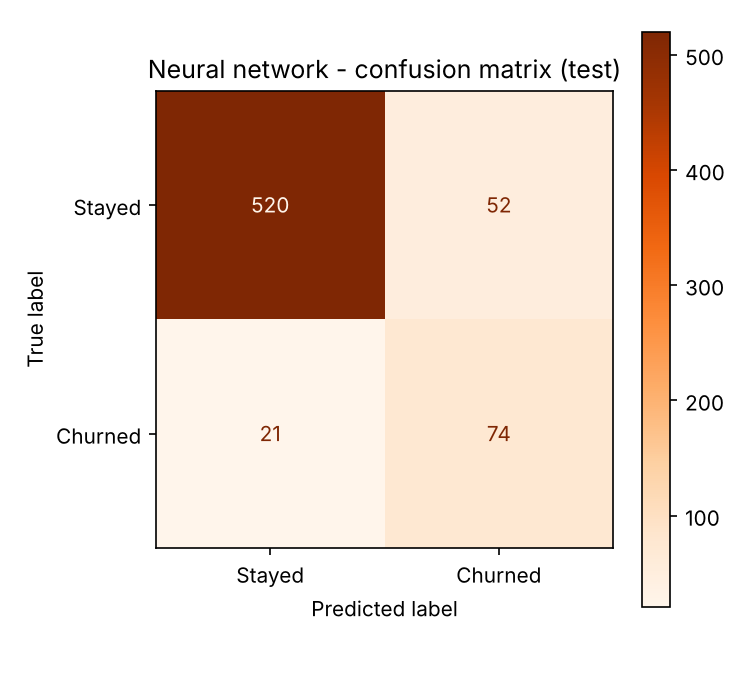
</p>

---

## 💡 Actionable Business Insights

Based on clustering profiles, permutation importances, and decision tree boundaries:

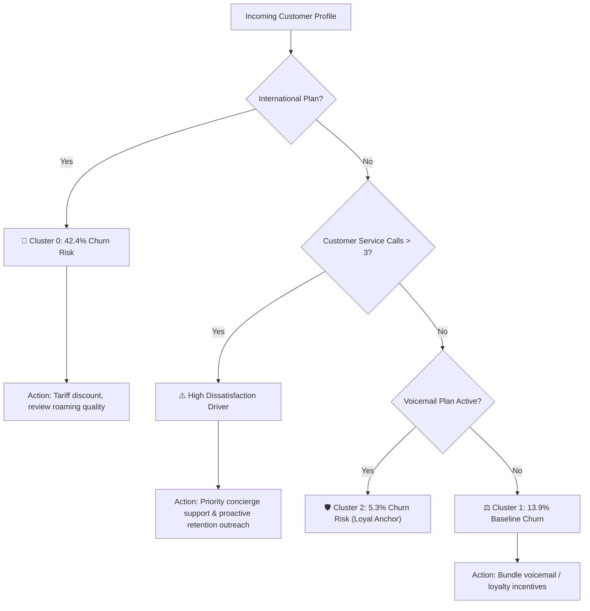

1. **The International Plan Anomaly (42.4% Churn)**:
   Customers enrolled in the international plan churn at nearly three times the average rate despite identical voice usage. This points strongly toward uncompetitive overseas rates, hidden roaming fees, or connection quality dissatisfaction.
2. **The 3-Call Support Tipping Point**:
   Feature importance identifies `Customer service calls` as the second highest predictor of churn. A customer making $\ge 4$ support calls has an exponential probability of churn, signaling unresolved service friction.
3. **Voicemail Plan as a Retention Anchor**:
   Customers subscribed to voicemail exhibit only 5.3% churn. Promoting free voicemail onboarding during contract renewal could significantly suppress attrition.

---

## 🛠️ Quickstart & Reproduction

### 1. Clone & Set Up Environment

```bash
git clone https://github.com/mahadir04/Codveda-Technologies-Machine-Learning-Project.git
cd Codveda-Technologies-Machine-Learning-Project

# Create and activate virtual environment
python -m venv .venv
source .venv/bin/activate       # On Linux/macOS
.venv\Scripts\activate          # On Windows

# Install master dependencies
pip install -r requirements.txt
```

### 2. Run Pipeline End-to-End

```bash
# Level 1: Basic
cd codveda-ml-basic
python src/task1_preprocessing.py
python src/task3_knn.py
cd ..

# Level 2: Intermediate
cd codveda-ml-intermediate
python task2_decision_tree_iris.py
python task3_kmeans_customer_segmentation.py
cd ..

# Level 3: Advanced
cd codveda-ml-advance
python task1_random_forest.py
python task3_neural_network.py
cd ..
```

---

## 📜 Deliverables & Artifacts Index

| Level | Script / Source | Primary Artifacts Generated |
| :--- | :--- | :--- |
| **Level 1** | `codveda-ml-basic/src/task1_preprocessing.py` | `data/processed/X_train.csv`, `X_test.csv`, `y_train.csv`, `y_test.csv` |
| **Level 1** | `codveda-ml-basic/src/task3_knn.py` | `churn_accuracy_vs_k.png`, `churn_confusion_matrix.png`, `iris_accuracy_vs_k.png`, `iris_confusion_matrix.png`, `*_k_comparison.csv` |
| **Level 2** | `codveda-ml-intermediate/task2_decision_tree_iris.py` | `iris_tree_structure.png`, `iris_pruning_curve.png`, `iris_confusion_matrices.png`, `iris_feature_importance.png`, `iris_tree_metrics.csv` |
| **Level 2** | `codveda-ml-intermediate/task3_kmeans_customer_segmentation.py` | `kmeans_elbow.png`, `kmeans_clusters_pca.png`, `kmeans_clusters_raw.png`, `kmeans_cluster_heatmap.png`, `kmeans_cluster_profiles.csv`, `churn_with_clusters.csv` |
| **Level 3** | `codveda-ml-advance/task1_random_forest.py` | `rf_tuning.png`, `rf_confusion_matrix.png`, `rf_feature_importance.png`, `rf_threshold_sweep.png`, `rf_results.json` |
| **Level 3** | `codveda-ml-advance/task3_neural_network.py` | `nn_training_curves.png`, `nn_confusion_matrix.png`, `nn_results.json`, `churn_mlp.keras` |

---

## 👨‍💻 Author

**Mahadir**  
- **GitHub**: [@mahadir04](https://github.com/mahadir04)  
- **Repository**: [Codveda-Technologies-Machine-Learning-Project](https://github.com/mahadir04/Codveda-Technologies-Machine-Learning-Project)

---
*Developed as part of the Codveda Technologies Machine Learning Internship Assessment.*
